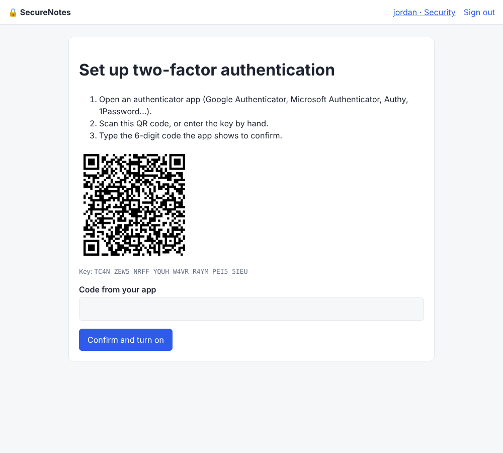
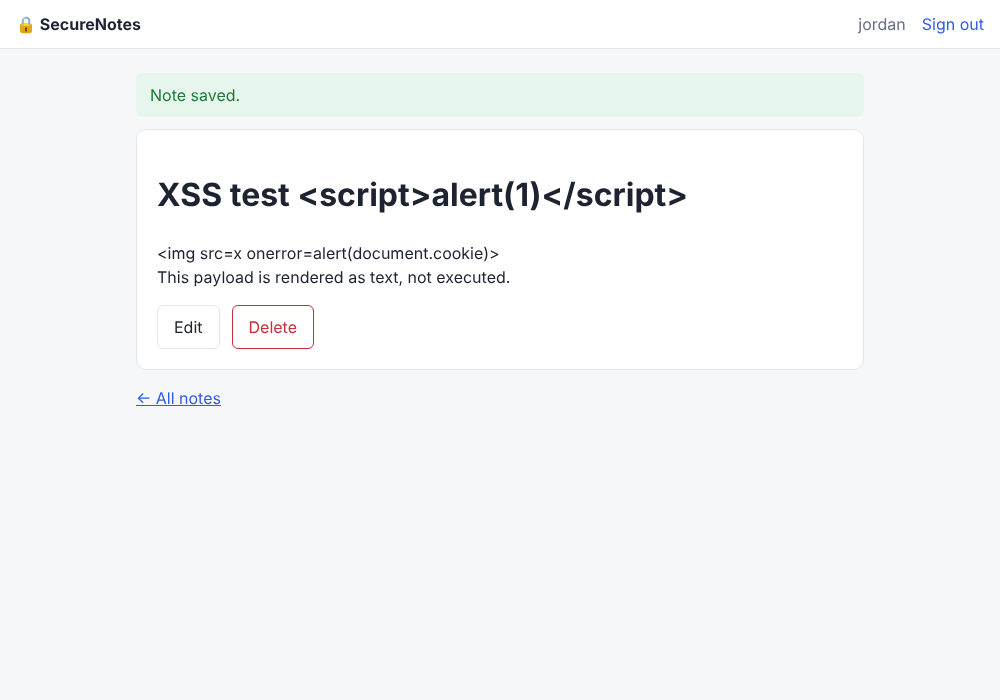

# SecureNotes

**A small Flask notes app built to show secure coding against the OWASP Top 10, with a DevSecOps pipeline that scans every push.**

The app itself is deliberately simple (register, sign in, create private notes) so the focus stays on the security engineering: every defense is in the code, explained in a comment, and proven by a test.

| Two-factor authentication setup | Stored XSS payload rendered harmlessly |
|---|---|
|  |  |

## Multi-factor authentication

Users can turn on two-factor authentication with any authenticator app (Google Authenticator, Microsoft Authenticator, Authy, 1Password). TOTP is implemented from the spec in [`securenotes/totp.py`](securenotes/totp.py) rather than imported from a library, and the tests check it against the official RFC 6238 test vectors.

* **Setup is safe to abandon.** The new secret stays in the session until the user types a valid code, so a half-finished setup can't lock anyone out.
* **Password alone isn't a login.** After the password check the session only holds a "pending" marker that expires in 5 minutes, and nothing else is reachable until the second factor passes.
* **Replay protection.** The last used time step is stored, so a code that was phished or shoulder-surfed can't be reused within its 30-second window.
* **Brute-force protection.** Wrong codes count toward the same lockout as wrong passwords, and the code form is rate limited to 5 tries a minute.
* **Recovery codes.** Ten single-use backup codes are shown once and stored only as Argon2id hashes.
* **Turning MFA off needs both factors** (password and a current code), so a hijacked session alone can't remove it.
* Constant-time code comparison with `hmac.compare_digest`, and audit events for `mfa_enabled`, `mfa_challenge`, `recovery_code_used` and `mfa_disabled`.

## OWASP Top 10 (2021) coverage

| Risk | Defense in SecureNotes | Where | Proven by |
|---|---|---|---|
| **A01 Broken Access Control** | Every note query is scoped to the signed-in user, and another user's note returns 404 rather than 403, so IDs can't be probed. `?next=` redirects only follow relative paths. State changes are POST-only. | `notes.py` `_get_own_note`, `auth.py` `_safe_next` | `test_idor_other_users_notes_are_invisible`, `test_open_redirect_blocked` |
| **A02 Cryptographic Failures** | Argon2id password hashing with per-password salts and automatic rehash when cost settings rise. `Secure`, `HttpOnly`, `SameSite` and `__Host-` session cookies plus HSTS in production. | `models.py`, `config.py` | `test_passwords_are_hashed_with_argon2id`, `test_secrets_and_recovery_codes_are_not_stored_in_plaintext`, `test_hsts_and_secure_cookies_in_production` |
| **A03 Injection** | SQLAlchemy ORM with bound parameters (no string-built SQL). Jinja autoescaping plus a strict CSP with no `unsafe-inline`, so even a missed XSS can't run inline script. | `auth.py`, templates, `security.py` | `test_sql_injection_in_login_is_harmless`, `test_stored_xss_is_escaped` |
| **A04 Insecure Design** | Account lockout and rate limiting were designed in from the start, not bolted on. Request bodies are capped at 64 KB. | `auth.py`, `config.py` | `test_account_lockout_after_repeated_failures`, `test_input_length_limits` |
| **A05 Security Misconfiguration** | Security headers on every response (CSP, `X-Frame-Options`, `nosniff`, `Referrer-Policy`, `Permissions-Policy`, COOP/CORP). Debug mode is always off. Generic error pages. The app refuses to start in production without a `SECRET_KEY`. Container runs as non-root. | `security.py`, `__init__.py`, `Dockerfile` | `test_security_headers`, `test_production_refuses_to_start_without_secret_key`, `test_errors_do_not_leak_internals` |
| **A06 Vulnerable Components** | Pinned dependencies, `pip-audit` on every push and weekly, Dependabot for pip, Actions and Docker, and Trivy scanning of the built image. | `requirements.txt`, `.github/` | CI |
| **A07 Identification & Authentication Failures** | TOTP multi-factor authentication with recovery codes. 12-128 character passwords (NIST 800-63B style), common-password and username checks, generic login errors, timing equalization for unknown users, lockout after 5 failures, login rate limit, session rotation on login. | `totp.py`, `account.py`, `forms.py`, `auth.py`, `models.py` | `test_mfa.py` (14 tests), `test_password_policy`, `test_login_errors_do_not_reveal_which_part_was_wrong`, `test_session_is_rotated_on_login` |
| **A08 Software & Data Integrity Failures** | CSRF tokens on every form, including logout and delete. Gitleaks blocks committed secrets. | `forms.py`, templates, CI | `test_csrf_blocks_forged_posts` |
| **A09 Logging & Monitoring Failures** | Security events (`register`, `login_success`, `login_failed`, `account_locked`, `idor_attempt`, `logout`) go to a dedicated audit logger in `key=value` form for SIEM ingestion. | `security.py` `audit()` | `test_idor_other_users_notes_are_invisible` checks the log |
| **A10 Server-Side Request Forgery** | The app never fetches user-supplied URLs, so there is no SSRF surface. | | |

Example audit log lines:

```
INFO securenotes.audit event=register user=- ip=127.0.0.1 username='jordan'
INFO securenotes.audit event=login_success user=1 ip=127.0.0.1 username='jordan'
INFO securenotes.audit event=idor_attempt user=2 ip=127.0.0.1 note_id='1'
```

## DevSecOps pipeline

`.github/workflows/security.yml` runs on every push, every pull request and weekly:

| Job | Tool | What it catches |
|---|---|---|
| Lint and tests | Ruff (including the `S` security rules), pytest | Regressions in any of the defenses above |
| SAST | Bandit, Semgrep (`p/python`, `p/flask`, `p/owasp-top-ten`) | Insecure code patterns such as injection, unsafe redirects, disabled CSRF |
| Dependencies | pip-audit | Known CVEs in pinned packages |
| Secrets | Gitleaks | API keys or passwords committed to history |
| Container | Trivy | High and critical vulnerabilities in the Docker image |

Semgrep flagged the original login redirect as a possible open redirect. The redirect target was already validated by `_safe_next`, but the code was restructured so the validated value is explicit, and a test pins the behavior.

## Run it

```bash
git clone https://github.com/<your-username>/securenotes.git
cd securenotes
python -m venv .venv && source .venv/bin/activate
pip install -r requirements-dev.txt

pytest -q                         # 45 security-focused tests
flask --app wsgi run              # http://127.0.0.1:5000 (development config)
```

With Docker (production config, so `SECRET_KEY` is required):

```bash
docker build -t securenotes .
docker run -p 8000:8000 -e SECRET_KEY="$(python -c 'import secrets; print(secrets.token_hex(32))')" \
           -v securenotes-data:/data securenotes
```

Production expects to sit behind a TLS-terminating reverse proxy, since cookies are marked `Secure`.

## Project layout

```
securenotes/
├── __init__.py     # app factory, error handlers
├── config.py       # development / testing / production settings
├── extensions.py   # SQLAlchemy, CSRF, rate limiter, login manager
├── models.py       # User (Argon2id, lockout) and Note
├── forms.py        # WTForms validation and password policy
├── auth.py         # register, login (password + MFA step), logout
├── account.py      # turn two-factor authentication on and off
├── totp.py         # RFC 6238 TOTP and recovery code generation
├── notes.py        # note CRUD with ownership checks
├── security.py     # security headers and audit logging
├── templates/      # Jinja templates, no inline JS or CSS
└── static/style.css
tests/              # test_auth.py, test_mfa.py, test_notes.py, test_hardening.py
```

## What I'd add next

* WebAuthn / passkeys as a phishing-resistant second factor.
* Encrypting the TOTP secret at rest with a key kept outside the database.
* Checking new passwords against Have I Been Pwned's k-anonymity API.
* Encrypting note bodies at rest with a per-user key.
* A DAST stage running OWASP ZAP against the container in CI.

## License

MIT
